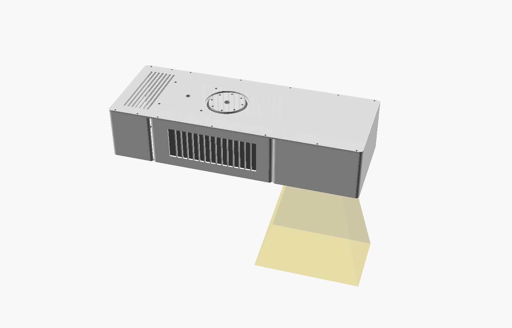
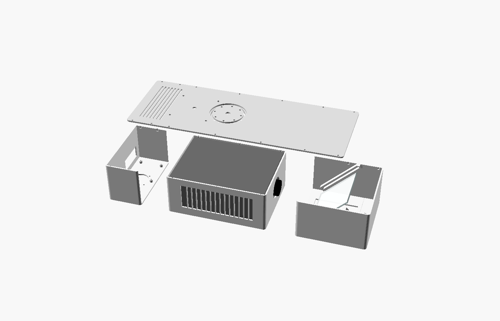
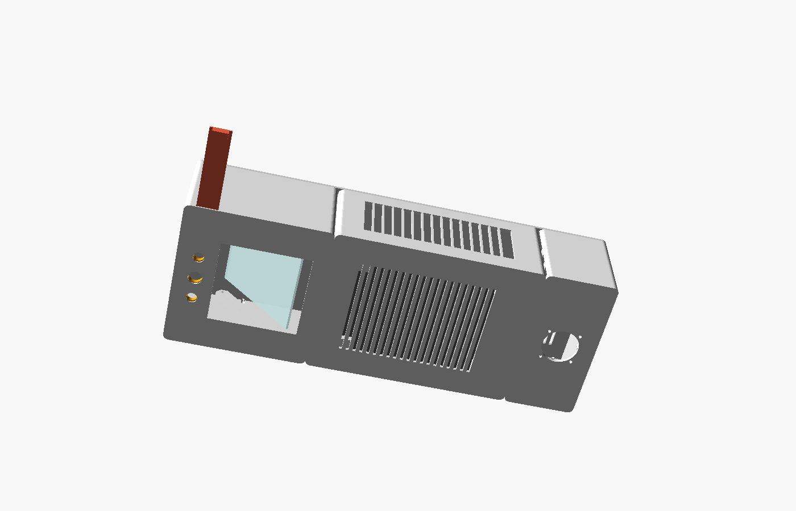
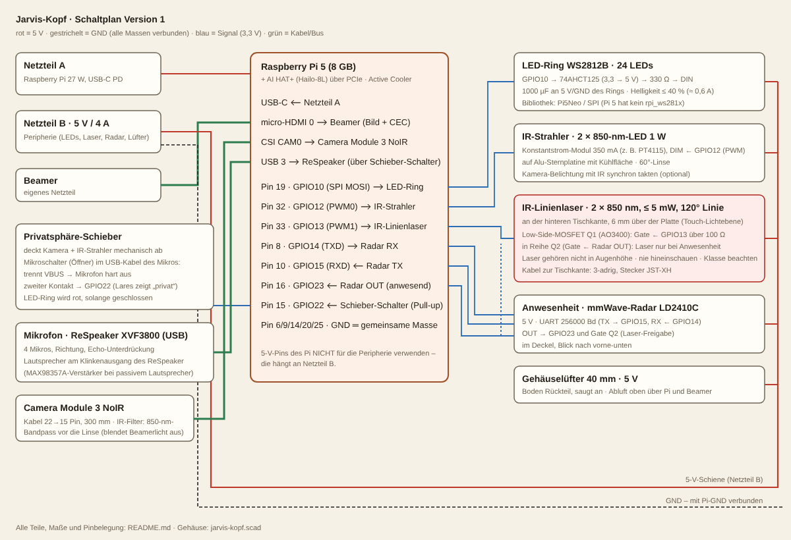

# Jarvis-Kopf · Version 1

Ein selbstgebauter „Kopf“ für den Schreibtisch. Er projiziert die Oberfläche von oben auf die
Tischplatte, sieht Hände und Gegenstände mit einer IR-Kamera, erkennt Berührungen über eine
IR-Lichtebene, hört über ein Mikrofon-Array zu und zeigt seinen Zustand mit einem LED-Ring.
Software-seitig ist er ein Satellit von Lares: ein Room auf dem Kopf selbst oder auf dem Lares-Gerät.



## Prinzip

- Der Beamer liegt **waagerecht** in der Wanne (Grundplatte).
- Vor dem Objektiv sitzt ein **45°-Oberflächenspiegel** (first surface, sonst entstehen Doppelbilder),
  der das Bild senkrecht nach unten auf den Tisch lenkt.
- Neben dem Projektionsfenster schauen die **Camera Module 3 NoIR** mit 850-nm-Bandpass und zwei
  **850-nm-IR-Strahler** nach unten. Der Bandpass blendet das Beamerbild aus: die Kamera sieht nur
  Hände und Gegenstände, nicht die eigene Projektion.
- **Touch:** Zwei IR-Linienlaser an der hinteren Tischkante spannen 6 mm über der Platte eine
  Lichtebene auf. Ein Finger, der den Tisch berührt, erzeugt einen hellen Punkt im Kamerabild.
- **Radar** LD2410C erkennt, ob jemand am Tisch sitzt (Bildschirm an/aus, Laser-Freigabe).
- **Privatsphäre-Schieber** deckt Kamera und IR mechanisch ab und trennt das Mikrofon hart vom Strom.
- Hinten im Gehäuse sitzt der **Pi 5 mit AI HAT+ (Hailo-8L)** für Hand- und Objekterkennung.




## Geometrie

Die Montagehöhe ergibt sich aus dem Projektionsverhältnis (Throw Ratio, TR) des Beamers.
Werte für ein 80 cm breites Bild:

| Beamer-TR | Abstand Objektiv → Tisch | Montagehöhe ca. | Spiegel mindestens | Hinweis |
|---|---|---|---|---|
| 1,2 (Standard) | 96 cm | 90 cm über dem Tisch | 80 × 82 mm | passt zu 100 × 100 mm |
| 0,8 (Kurzdistanz) | 58 cm | 52 cm | 105 × 102 mm | Spiegel 120 mm, Parameter `spiegel` anpassen |
| 0,5 (Ultrakurz) | 34 cm | 28 cm | 150 × 138 mm | großer Spiegel + Camera Module 3 **Wide** |

Die Camera Module 3 NoIR (66° × 41°) sieht aus 90 cm etwa 117 × 67 cm – also die ganze Projektion mit Rand.

## Stückliste

Preise inkl. MwSt., Stand Oktober 2026, ohne Versand. „recherchiert“ = aktueller Shoppreis,
sonst Schätzung. Vor dem Kauf im Shop prüfen.

| # | Teil | Anzahl | € gesamt | Quelle |
|---|---|---|---|---|
| 1 | Raspberry Pi 5, 8 GB | 1 | 189,00 | BerryBase, recherchiert |
| 2 | Raspberry Pi AI HAT+ (Hailo-8L, 13 TOPS) | 1 | 79,61 | buyzero.de, recherchiert |
| 3 | Pi 5 Active Cooler | 1 | 5,90 | BerryBase, recherchiert |
| 4 | Pi 27-W-Netzteil USB-C (Netzteil A) | 1 | 12,40 | BerryBase, recherchiert |
| 5 | microSD 64 GB (A2) oder USB-Stick für Lares OS | 1 | 12 | Schätzung |
| 6 | micro-HDMI → HDMI-Kabel, 0,5 m | 1 | 8 | Schätzung |
| 7 | Camera Module 3 NoIR | 1 | 28,90 | BerryBase, recherchiert |
| 8 | 850-nm-Bandpassfilter, 12 mm | 1 | 10 | Schätzung |
| 9 | Kamerakabel 22 → 15 Pin, 300 mm | 1 | 3 | Schätzung |
| 10 | ReSpeaker XVF3800 USB (4 Mikros) | 1 | 58,64 | Open eLab, recherchiert |
| 11 | WS2812B-Ring 24 LEDs (Ø 66 mm) | 1 | 7 | Schätzung |
| 12 | 74AHCT125 + 330 Ω + 1000 µF | 1 | 3 | Schätzung |
| 13 | 850-nm-LED 1 W auf Sternplatine + 60°-Linse | 2 | 8 | Schätzung |
| 14 | Konstantstrom-Modul 350 mA (PT4115) | 1 | 3 | Schätzung |
| 15 | IR-Linienlaser 850 nm, **≤ 5 mW**, Ø 12 mm | 2 | 59 | Ampul.eu ≈ 29,60 €/Stk., recherchiert |
| 16 | AO3400 MOSFET + 100 Ω + 10 kΩ | 2 | 2 | Schätzung |
| 17 | mmWave-Radar HLK-LD2410C | 1 | 6 | eBay ab 4,94 €, recherchiert |
| 18 | Mikroschalter (Öffner + Schließer) | 1 | 2 | Schätzung |
| 19 | Lüfter 40 × 10 mm, 5 V | 1 | 5 | Schätzung |
| 20 | Netzteil 5 V / 4 A (Netzteil B) | 1 | 12 | Schätzung |
| 21 | Oberflächenspiegel 100 × 100 mm | 1 | 12 | Adamer ab 7,99 €, Größe prüfen |
| 22 | M3-Gewindeeinsätze + Schrauben 8/12 mm | ~40 | 10 | Schätzung |
| 23 | Kabel, JST-XH-Stecker, Lochrasterplatine | – | 10 | Schätzung |
| 24 | Gummifüße, 1/4"-Einschlagmutter | – | 5 | Schätzung |
| 25 | PETG ca. 600 g | – | 15 | Schätzung |
| | **Summe ohne Beamer** | | **≈ 570** | |
| | optional: Monitorarm / VESA-Halter | 1 | 25–40 | Schätzung |

Sparen: IR-Linienlaser gibt es bei AliExpress für ca. 10 €/Stk. (Laserklasse und Leistung genau
prüfen). Ohne Laser-Touch entfallen Nr. 15 und 16 (≈ 60 €).

## Pinbelegung

| Pi-Pin | GPIO | an |
|---|---|---|
| 19 | GPIO10 (SPI MOSI) | LED-Ring über 74AHCT125 → 330 Ω → DIN |
| 32 | GPIO12 (PWM0) | IR-Strahler, DIM-Eingang PT4115 |
| 33 | GPIO13 (PWM1) | IR-Linienlaser, Gate Q1 über 100 Ω |
| 8 | GPIO14 (TXD) | Radar RX |
| 10 | GPIO15 (RXD) | Radar TX (256000 Bd) |
| 16 | GPIO23 | Radar OUT (anwesend) – zusätzlich Gate Q2 |
| 15 | GPIO22 | Schieber-Schalter, interner Pull-up |
| 6/9/14/20/25 | GND | gemeinsame Masse mit Netzteil B |
| CSI CAM0 | – | Camera Module 3 NoIR |
| micro-HDMI 0 | – | Beamer |
| USB 3 | – | ReSpeaker (VBUS über den Schieber-Schalter) |

Die gesamte Peripherie hängt an **Netzteil B**, nicht an den 5-V-Pins des Pi. Massen verbinden.



## Drucken

- Material **PETG** (der Beamer wird warm, PLA verzieht sich), 0,2 mm Schicht, 4 Wände, 25 % Gyroid.
- Alle Teile passen auf ein 220 × 220-mm-Bett; der Deckel ist dafür dreigeteilt.
- `grundplatte` und `rueckteil` mit der offenen Seite nach oben drucken, `spiegelbox` mit der Rückseite
  aufs Bett, Stützen nur für die Spiegelauflage.
- Gewindeeinsätze M3 mit dem Lötkolben bei ca. 220 °C einsetzen.

| Datei | Maße (mm) |
|---|---|
| `stl/grundplatte.stl` | 210 × 160 × 88 |
| `stl/spiegelbox.stl` | 145 × 160 × 88 |
| `stl/rueckteil.stl` | 74 × 160 × 88 |
| `stl/deckel_vorne.stl` | 145 × 160 × 3 |
| `stl/deckel_mitte.stl` | 210 × 160 × 8 |
| `stl/deckel_hinten.stl` | 74 × 160 × 3 |
| `stl/kamerahalter.stl` | 30 × 64 × 4 |
| `stl/schieber.stl` | 21 × 116 × 7,4 |
| `stl/laserhalter.stl` (2 ×) | 40 × 30 × 12 |

## Zusammenbau

1. Gewindeeinsätze in alle Teile setzen.
2. Grundplatte, Spiegelbox und Rückteil verschrauben.
3. Spiegel mit der verspiegelten Seite nach unten-vorne auf die 45°-Auflage legen, mit zwei Tropfen
   Silikon an den Ecken fixieren (nicht vollflächig kleben – Spannung verzieht das Bild).
4. Kamera auf den Kamerahalter, Bandpass vor die Linse, Halter von innen über das Kamerafenster schrauben.
   IR-Strahler links und rechts davon einsetzen.
5. Schieber in den Schlitz schieben, Mikroschalter so ausrichten, dass er bei geschlossenem Schieber öffnet.
6. Pi 5 mit AI HAT+ auf die Abstandshalter im Rückteil, Lüfter in den Boden, Kabel durch die Rückseite.
7. Beamer in die Wanne legen, Objektiv mittig vor den Spiegel.
8. LED-Ring, ReSpeaker und Radar am mittleren Deckelteil befestigen, alle drei Deckelteile aufschrauben.
9. Gehäuse mit 1/4"-Gewinde oder VESA 75 an einen Monitorarm oder Wandausleger hängen.
10. Laserhalter an der hinteren Tischkante festkleben oder -schrauben, Laser 6 mm über der Platte waagerecht ausrichten.

## Kalibrierung

1. Lares projiziert ein ArUco-Muster auf den Tisch.
2. Die Kamera findet die Marker und berechnet die **Homographie** Kamera ↔ Projektion.
3. Danach landet jeder erkannte Finger- oder Laserpunkt an der richtigen Stelle der Oberfläche.
4. Bei Verschieben des Kopfs einfach neu kalibrieren (dauert ein paar Sekunden).

## Lasersicherheit

- Nur Linienlaser mit **höchstens 5 mW** verwenden; 850 nm ist unsichtbar, der Lidschlussreflex schützt nicht.
- Die Lichtebene liegt 6 mm über der Tischplatte – **nie in Augenhöhe** montieren, nie in den Laser schauen.
- Q2 schaltet die Laser nur ein, wenn das Radar jemanden sieht; Q1 gibt die Software frei.
  Beide müssen leiten, damit die Laser leuchten.
- Wer auf Laser verzichten will: Touch funktioniert auch nur über Handerkennung (etwas ungenauer).

## Software

Der Kopf läuft als **Jarvis-Room** in Lares, entweder direkt auf dem Pi 5 mit Lares OS oder als
Satellit eines anderen Lares-Geräts. Rechte im `room.yaml`:

```yaml
rechte:
  usb: [respeaker]       # Mikrofon
  ki: true               # Sprache und Antworten über die KI von Lares
  befehle: true          # Geräte und Rooms steuern
  standort: true         # Wetter, Sonnenstand
```

Hand- und Objekterkennung laufen lokal auf dem Hailo, Sprache über die KI-Anbindung von Lares.
Kamera und Mikrofon sind aus, solange der Schieber zu ist; Lares zeigt das im Atrium an.

## Anpassen

Alles ist parametrisch in `jarvis-kopf.scad`. Zuerst den eigenen Beamer messen und oben eintragen:

| Parameter | Bedeutung | Vorgabe |
|---|---|---|
| `beamer_l`, `beamer_b`, `beamer_h` | Außenmaße des Beamers | 200, 150, 75 |
| `objektiv_z` | Höhe der Objektivmitte über der Auflage | 38 |
| `objektiv_x` | seitlicher Versatz des Objektivs zur Mitte | 0 |
| `objektiv_d` | Objektivdurchmesser | 34 |
| `spiegel`, `spiegel_dicke` | Spiegelkante und -dicke | 100, 3 |
| `spiegel_abstand` | Objektiv bis Spiegelmitte | 60 |
| `wand`, `luft` | Wandstärke, Spiel um den Beamer | 3, 2 |

Bilder und STLs neu erzeugen:

```sh
# einzelnes Teil als STL
openscad -o stl/spiegelbox.stl -D 'teil="spiegelbox"' jarvis-kopf.scad

# alle Teile
for t in grundplatte spiegelbox rueckteil deckel_vorne deckel_mitte deckel_hinten kamerahalter schieber laserhalter; do
  openscad -o stl/$t.stl -D "teil=\"$t\"" jarvis-kopf.scad
done

# Vorschaubild
openscad -o bilder/zusammen.png -D 'teil="zusammen"' --imgsize=1400,900 \
  --camera=-100,330,250,0,0,0 --autocenter --viewall --colorscheme=Tomorrow jarvis-kopf.scad
```

Weitere Werte für `teil`: `zusammen`, `explosion`, `unten`.
